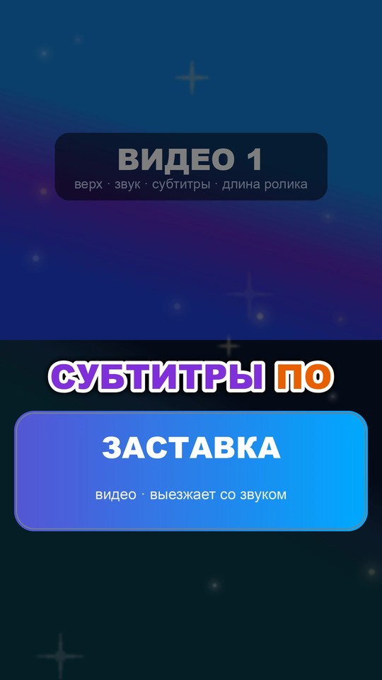
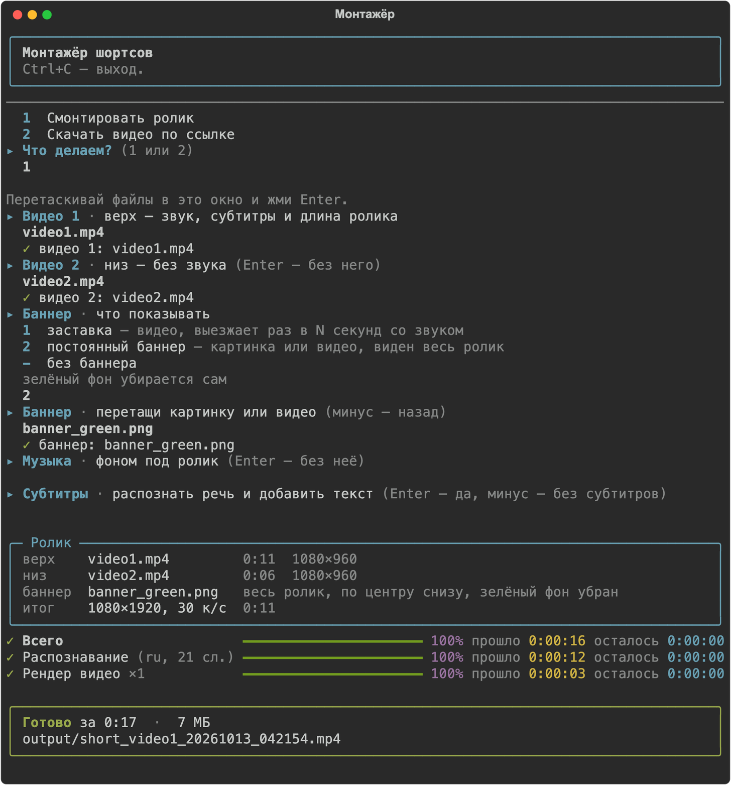
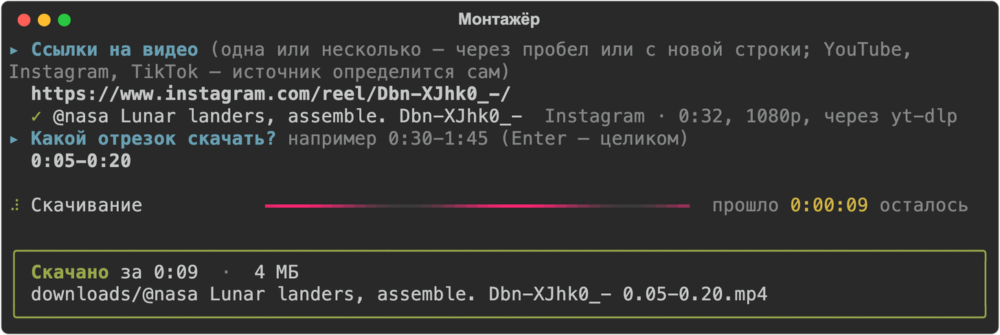
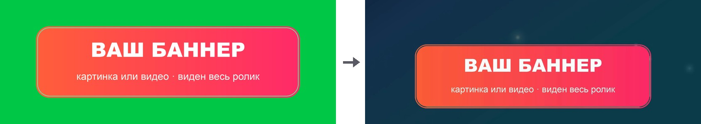

<p align="center">
  
</p>

<h1 align="center">Монтажёр шортсов</h1>

<p align="center">
  Собирает вертикальные ролики 1080×1920 для Shorts, Reels и TikTok: два видео друг над другом,<br>
  субтитры по словам, баннер и музыка. Умеет сам скачивать исходники по ссылке.
</p>

<p align="center">
  <a href="https://github.com/gjast/montager/releases/latest/download/Montager.exe"><b>Скачать для Windows</b></a>
  &nbsp;·&nbsp;
  <a href="#запуск-на-mac">Запуск на Mac</a>
</p>

Программа работает в окне терминала: задаёт несколько вопросов, файлы достаточно перетащить в окно.
Настраивать монтаж руками не нужно — на выходе готовый ролик.

<p align="center">
  
  &nbsp;&nbsp;
  
</p>
<p align="center">
  <sub>Кадры из готового ролика. Слева постоянный баннер, справа заставка: на время показа фон темнеет.</sub>
</p>

## Что умеет

**Монтаж**

- **Два видео в одном кадре.** Видео 1 сверху — задаёт длину ролика и звук. Видео 2 снизу — без
  звука, зацикливается, если короче. Без второго видео первое занимает кадр целиком.
- **Субтитры по словам.** Речь распознаётся сама, текст идёт короткими фразами, произносимое слово
  подсвечивается. Цвета для каждого ролика выбираются случайно из нескольких пар.
- **Баннер — два вида на выбор:**
  - *постоянный* — картинка или видео по кругу, виден весь ролик по центру снизу;
  - *заставка* — видео, выезжает раз в N секунд со своим звуком; на это время фон темнеет,
    а звук ролика и музыка замолкают.
- **Зелёный фон убирается сам.** Баннер не обязательно готовить с прозрачностью: достаточно
  картинки или видео на зелёном фоне.
- **Музыка** фоном под весь ролик, с затуханием в конце.
- **Чёрные поля** в исходниках находятся сами и заменяются размытой копией кадра.
- **Частицы** поверх картинки — лёгкий живой фон.
- **Быстрый рендер:** ролик режется на куски, они считаются одновременно и склеиваются.

**Скачивание**

- **YouTube, Instagram, TikTok** — источник определяется по ссылке.
- **Отрезок:** можно скачать не всё видео, а кусок, например `0:30-1:45`.
- **Несколько ссылок сразу** — через пробел или столбиком. Ошибка на одной не останавливает остальные.
- **Запасные способы.** Для каждого сайта их несколько; если один не сработал, пробуется следующий.

## Как это выглядит

<p align="center">
  
</p>
<p align="center"><sub>Монтаж: вопросы, сводка по ролику и ход работы.</sub></p>

<p align="center">
  
</p>
<p align="center"><sub>Скачивание: источник определён сам, выбран отрезок.</sub></p>

## Запуск на Windows

1. Скачай [Montager.exe](https://github.com/gjast/montager/releases/latest/download/Montager.exe)
   и положи в отдельную папку — рядом появятся `output` (готовые ролики), `downloads` и настройки.
2. Запусти. Windows покажет предупреждение «Система Windows защитила ваш компьютер»: файл не
   подписан сертификатом. Нажми **Подробнее → Выполнить в любом случае**.
3. При первом запуске программа скачает свои файлы (около 240 МБ). При первых субтитрах —
   ещё модель распознавания речи (около 1,6 ГБ, один раз).

Нужна 64-битная Windows 10 или 11. Ничего ставить отдельно не надо: Python и ffmpeg программа
приносит с собой.

**Обновляется сама.** При каждом запуске программа проверяет, не вышла ли новая версия, докачивает
изменившееся (обычно около 10 МБ) и открывается уже обновлённой. Без интернета запускается то,
что установлено.

## Запуск на Mac

Нужны [Homebrew](https://brew.sh), ffmpeg и Python 3.11–3.14:

```bash
brew install ffmpeg python@3.14
```

Дальше — двойной клик по `Монтажер.command`. При первом запуске он сам создаст окружение и поставит
библиотеки из `requirements.txt`.

## Как пользоваться

**Смонтировать ролик** — пункт `1` в меню. Программа спросит по очереди:

| Вопрос | Что дать |
|---|---|
| Видео 1 | основное видео: его звук, длина и субтитры |
| Видео 2 | фон для нижней половины; Enter — без него |
| Баннер | `1` — заставка (видео), `2` — постоянный баннер (картинка или видео), `-` — без баннера |
| Музыка | звуковой файл; Enter — без музыки |
| Субтитры | Enter — распознать речь, `-` — без субтитров |

Файлы можно перетаскивать в окно мышью. Баннер запоминается: в следующий раз достаточно нажать Enter.

**Фон баннера.** Подойдёт файл с прозрачным фоном (PNG, видео с альфа-каналом) или на ровном
зелёном фоне — его программа вырежет сама и напишет об этом в сводке. Звук у постоянного
видео-баннера не используется, звук есть только у заставки.

<p align="center">
  
</p>
<p align="center"><sub>Слева файл баннера на зелёном фоне, справа он же в готовом ролике.</sub></p>

**Скачать видео** — пункт `2`. Вставь одну или несколько ссылок. Для одной ссылки программа предложит
выбрать отрезок, несколько ссылок скачает целиком по очереди.

**Без вопросов, одной командой:**

```bash
python montage.py видео1.mp4 видео2.mp4 баннер.png --music музыка.mp3
```

| Параметр | Что делает |
|---|---|
| `--music ФАЙЛ` | фоновая музыка |
| `--every N` | как часто показывать заставку, сек (по умолчанию 30) |
| `--always` | видео-баннер показывать весь ролик, а не заставкой |
| `--no-subs` | без субтитров |
| `--lang ru` | язык речи; по умолчанию определяется сам |
| `--model ИМЯ` | модель распознавания (по умолчанию `large-v3-turbo`) |
| `-j N` | сколько кусков рендерить одновременно (по умолчанию 4) |
| `-o ФАЙЛ` | куда сохранить ролик |

Вместо видео 2 или баннера можно поставить `-`, чтобы пропустить. Баннер-картинка всегда виден
весь ролик; баннер-видео идёт заставкой, а с `--always` — постоянным баннером.

## Настройки

Всё, что касается вида ролика, — константы в начале `montage.py`:

| Константа | Что меняет |
|---|---|
| `INSERT_EVERY` | как часто показывать заставку |
| `V3_DIM`, `DUCK` | затемнение фона и громкость ролика на время заставки |
| `BAN_W`, `BAN_BOTTOM` | ширина постоянного баннера и отступ снизу |
| `BAN_FLOAT_X`, `BAN_FLOAT_Y` | покачивание постоянного баннера; по умолчанию 0 — стоит на месте |
| `CHROMA`, `CHROMA_SIMILARITY` | вырезание зелёного фона: включено ли и насколько смело |
| `SUB_FONT_SIZE`, `SUB_CENTER_Y`, `SUB_PAIRS` | размер, положение и цвета субтитров |
| `MUSIC_VOLUME` | громкость музыки |
| `PARTICLES` | число частиц (0 — выключить) |
| `VIDEO_BITRATE` | качество итогового ролика |

## Что используется

| Что | Зачем |
|---|---|
| [Python](https://www.python.org) | на нём написана программа |
| [ffmpeg](https://ffmpeg.org) | сборка кадра, наложения, звук, кодирование |
| [faster-whisper](https://github.com/SYSTRAN/faster-whisper) | распознавание речи с временем каждого слова |
| [Pillow](https://python-pillow.org) | отрисовка субтитров и частиц |
| [rich](https://github.com/Textualize/rich) | интерфейс в терминале |
| [yt-dlp](https://github.com/yt-dlp/yt-dlp) | скачивание: YouTube, Instagram, TikTok и другие сайты |
| [pytubefix](https://github.com/JuanBindez/pytubefix) | YouTube: быстрая загрузка кусками |
| [parth-dl](https://github.com/parthmax2/parth-dl), [instaloader](https://github.com/instaloader/instaloader) | Instagram: запасные способы |
| [gallery-dl](https://github.com/mikf/gallery-dl) | TikTok: запасной способ |
| [PyInstaller](https://pyinstaller.org) | сборка `Montager.exe` |
| GitHub Actions | сборка и проверка выпусков на Windows |

Субтитры рисуются своим кодом и подаются в ffmpeg готовыми кадрами, поэтому программе хватает
любой сборки ffmpeg.

**Порядок способов скачивания**

| Сайт | Способы по очереди |
|---|---|
| YouTube | pytubefix → yt-dlp |
| Instagram | yt-dlp → parth-dl → instaloader → eeinstagram → kkinstagram |
| TikTok | yt-dlp → gallery-dl → fxTikTok |

Последние в цепочках Instagram и TikTok — сторонние сайты-посредники. Они сами ходят за роликом,
поэтому выручают, когда сайт ограничил запросы с твоего адреса. Им уходит только ссылка на ролик;
файл скачивается с серверов самих Instagram и TikTok, другие адреса программа не принимает.

Скачиваются только открытые ролики, без входа в аккаунт. Закрытые профили и сторис недоступны.

## Как устроены обновления на Windows

`Montager.exe` — маленькая запускалка, самой программы в нём нет. Программа разложена на три набора,
которые запускалка скачивает из [выпусков](https://github.com/gjast/montager/releases) и обновляет
по отдельности:

| Набор | Что внутри | Размер | Как часто меняется |
|---|---|---|---|
| `app` | программа и быстро устаревающие библиотеки (yt-dlp и другие) | ~10 МБ | с каждым выпуском |
| `runtime` | Python и тяжёлые библиотеки | ~150 МБ | редко |
| `ffmpeg` | ffmpeg и ffprobe | ~80 МБ | редко |

Каждый файл проверяется по контрольной сумме. Если обновление не скачалось или повреждено, программа
остаётся на прежней версии. Запускалка тоже умеет обновлять саму себя.

**Выпустить обновление** — отправить изменения в ветку `main`:

```bash
git push
```

GitHub соберёт новую версию на Windows, проверит её (установка с нуля, монтаж ролика, распознавание
речи, обновление запускалки) и опубликует. Если проверка не прошла, выпуск не выходит и у всех
остаётся прежняя версия. Сборку можно запустить и вручную во вкладке Actions — например, чтобы
подтянуть свежий yt-dlp.

## Что где лежит

| Файл | Что это |
|---|---|
| `montage.py` | монтаж и интерфейс |
| `download.py` | скачивание видео |
| `run.py` | точка входа при запуске через `Montager.exe` |
| `Монтажер.command` | запуск на Mac |
| `launcher/launcher.py` | запускалка для Windows с автообновлением |
| `tools/build_release.py` | сборка выпуска |
| `tools/smoke_test.py` | проверка выпуска на Windows |
| `.github/workflows/release.yml` | автоматическая сборка и публикация |

Готовые ролики сохраняются в `output`, скачанные видео — в `downloads`.

---

Скачивай и используй только те видео, на которые у тебя есть права.
